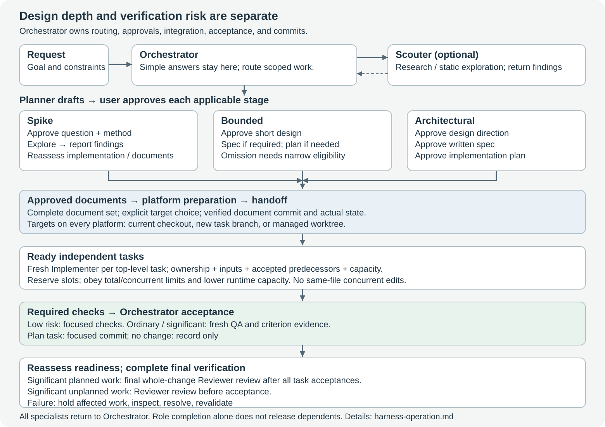

# ARC — Agent Role Coordination

ARC coordinates scoped roles, handoffs, and verification in Claude Code, Codex, Gemini CLI, and Grok CLI.

## Roles

| Role | Responsibility |
|---|---|
| Orchestrator | Routes work and accepts results |
| Scouter | Researches sources and explores the repository |
| Planner | Drafts designs, specs, and plans |
| Implementer | Makes assigned changes |
| QA | Runs assigned verification |
| Reviewer | Independently reviews changes |

## Install

| Requirement | Support |
|---|---|
| Environment | Node.js 22+, npm, Git, and network access. macOS 13+ or Linux with glibc 2.28+, on arm64 or x64. |
| Homes | ARC rejects symlinked platform homes or parents. `CLAUDE_CONFIG_DIR` must resolve to the default `~/.claude` if set. Leave `GEMINI_CLI_HOME` and `GROK_HOME` unset. |

Run `npm install --global @yunhozz/arc`, then run `arc` in an interactive terminal. To run without installing globally, use `npx --yes @yunhozz/arc`.

## Manage ARC

| Menu | Action |
|---|---|
| Configure | Choose role platforms, models, efforts, hosts, Run mode, language, and subagent limits. Select Apply to publish. |
| Status | View installed platforms, settings, diagnostics, and version. Select Upgrade when available. |
| Uninstall | Confirm removal of a platform or choose Everything (incl. CLI). |

| Mode | Meaning |
|---|---|
| Standalone | The selected role platforms and hosts form one participant. |
| Mixed | Two or more platforms participate. The first participant in Claude → Codex → Gemini → Grok order anchors routing. |
| Unverified | Apply is blocked. Inspect the reported paths. |

## Watch sessions

Run `arc watch` in an interactive terminal and choose **All**, Claude, or Codex to follow activity in the current worktree (or directory outside Git). Gemini and Grok appear as unsupported and cannot be selected. Run `arc watch --help` for options.

| Visibility | Events |
|---|---|
| Shown | Messages, SKILL and PLUGIN lines, and dispatch records. |
| Hidden | Tool and command outputs. Reasoning requires `--verbose`. Secret masking is incomplete. |

## Models and language

| Setting | Details |
|---|---|
| Orchestrator model | Current conversation model. |
| Specialist settings | [Claude](claude/skill/models.toml), [Codex](codex/skill/models.toml), [Gemini](gemini/skill/models.toml), [Grok](grok/skill/models.toml). Edit platform, model, and effort in Configure. |
| Catalogs | Configure lists packaged candidates. Account access to a model may vary. |
| Language | Configure sets the agent response language for new sessions. |

## Platform support

| Platform | Host | As bridge target | Auth check |
|---|---|---|---|
| Claude | Yes | All roles. Implementer and QA are sandboxed (`G1`). | `claude auth status` |
| Codex | Yes | All roles | `codex app-server` auth refresh (network) |
| Gemini | Held (`GG2`) | Read roles. Write roles are held (`GG1`). | None (`unknown`, `auth unverified`) |
| Grok | Yes | All roles. Write roles use a per-dispatch sandbox profile (`GK1`). | None (`unknown`, `auth unverified`) |

Standalone is verified for all four platforms in the registry. See [execution support](docs/harness-operation.md#execution-support) for measured coverage. Desktop environments are held. The caller declares `executionEnvironment` without inferring it from paths.

- Codex hosts require escalation approval on every runtime call.
- Start Grok hosts with `grok --permission-mode default` and use `Allow once` on every runtime call.

## Upgrade

- Status → Upgrade automatically reapplies the current configuration. Use Configure → Apply if reapplication is held or interrupted, its state is unknown, or this is the first npx upgrade from 0.4.6 or earlier. If the state is unknown, inspect the reported paths before retrying. In-progress plan workflows with changed versions are held under `cooperative.versions`.
- Before downgrading from Full Auto, switch Run mode to Supervised and Apply. Older CLIs read the v2 `settings.toml` as incomplete.
- After downgrading, run Configure in the older version to restore its composite layout.
- See [legacy migration](docs/harness-operation.md#install-update-remove) for older Mixed installations.

## Guides

[Harness operation](docs/harness-operation.md) · [Claude Code](claude/skill/SKILL.md) · [Codex](codex/skill/SKILL.md) · [Gemini CLI](gemini/skill/SKILL.md) · [Grok CLI](grok/skill/SKILL.md)
