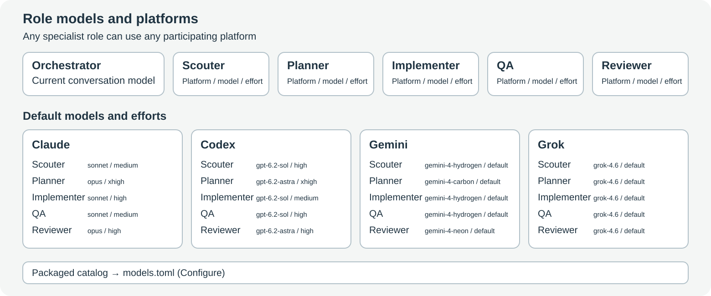

# ARC — Agent Role Coordination

ARC coordinates scoped roles, handoffs, and verification in Claude Code, Codex, and Gemini CLI.


## Roles

| Role | Responsibility |
|---|---|
| Orchestrator | Routes work and accepts results |
| Scouter | Researches sources and explores the repository |
| Planner | Drafts designs, specs, and plans |
| Implementer | Makes assigned changes |
| QA | Runs assigned verification |
| Reviewer | Independently reviews changes |

## Install

| Requirement | Support |
|---|---|
| Tools | Node.js 22+, npm, Git, network access |
| OS | macOS 13+ or Linux glibc 2.28+; no Windows or musl |
| CPU | arm64 or x64 |
| Homes | Symlinked platform homes or parents are refused for install, publication, and routing locks |

```sh
npm install --global @yunhozz/arc
arc
# Without a global install:
npx --yes @yunhozz/arc
```

The package provides the CLI; use the TUI to install the harness. Public commands: `arc`, `arc watch`, `arc --help`, `arc --version`; only the TUI requires terminal input/output.

## Manage ARC

| Home action | Effect |
|---|---|
| Configure | Edit role platform/model/effort, Hosts, Run mode (Supervised/Full Auto), Language, and subagent limits; `Apply` publishes; new sessions load profiles. Defaults: Supervised, English, 100 total/5 concurrent subagents; unchanged `(mixed)` settings preserve per-platform values |
| Status | Installed on, settings, platform status, diagnostics, and ARC version (current/latest or lookup failure); `Upgrade` appears only when a newer version exists and an ARC harness is installed, and preserves settings. Global upgrade exits ARC; npx leaves the global CLI unchanged |
| Uninstall | Remove a platform or `Everything (incl. CLI)` after confirmation (default `Back`); removing a Mixed participant restores others to standalone. Everything filters verified install/standalone platforms and removes CLI only after harness success. Unselected harnesses/user files remain. CLI only: `npm uninstall -g @yunhozz/arc` |

| Mode | Rule |
|---|---|
| Standalone | S = role platforms ∪ hosts; one participant |
| Mixed (…) | Two or more participants; hosts may have no roles; anchor order: Claude > Codex > Gemini > Grok |
| Unverified | `Apply` blocked; inspect inconsistent files/residual paths |

## Watch sessions


| Visibility | Behavior |
|---|---|
| Shown | Claude Code/Codex activity, full messages, one-line other events, SKILL/PLUGIN lines, dispatch records |
| Hidden | Tool/command outputs; reasoning unless verbose; common secrets masked incompletely |
| Excluded | Codex Desktop sessions; held bridges have no running activity |
| Scope | Current Git worktree or directory outside Git; events follow session cwd. Markers select the anchor store; legacy Codex fallback; conflicting anchors: `dispatch store ambiguous`; old-store history is not merged |

`arc watch --help` lists scope/history/platform/JSON options; Ctrl-L clears, Ctrl-C stops.

## Models and language



| Setting | Details |
|---|---|
| Orchestrator model | Current conversation |
| Specialist models | Installed [Claude](claude/skill/models.toml), [Codex](codex/skill/models.toml), [Gemini](gemini/skill/models.toml) settings; edit through role boxes |
| Catalogs | Packaged candidates only; no model-list call/API key; no proof of account availability |
| Language | English TUI; selected agent response language applies in new sessions |

## Platform and environment support

| Platform | Host? | Native roles | Bridges to this platform | Authentication |
|---|---|---|---|---|
| Claude | Yes | Supported on CLI | Scouter/Planner/Reviewer on Codex after per-call escalation; Implementer/QA held: `permission_scope_unverified` | `claude auth status` |
| Codex | Yes | Supported on CLI | From Claude; permissions claim capped at `operator-attested` | `codex app-server` refresh rotates `auth.json`; network required |
| Gemini | No | Standalone verified | Read roles verified; write roles held: `permission_scope_unverified` | No probe; `unknown`, `auth unverified` warning |
| Grok | No | Standalone enabled (not live-verified) | Read roles enabled (not live-verified); write roles held: `permission_scope_unverified`; Configure sets `[compat.claude]` agents/skills/rules to false in `~/.grok/config.toml` (session effect unverified) | No probe; `unknown`, `auth unverified` warning |

| executionEnvironment | Support and obligations |
|---|---|
| `claude-cli` | Native roles and Codex bridges |
| `codex-cli` | Native roles and Claude read-role bridges; every runtime call needs escalation approval, including native calls; refusal/denied `CODEX_HOME` write: `host_sandbox_blocked`. Runtime does not check approval |
| `claude-desktop`, `codex-desktop` | All native/bridge roles held: `environment_unverified` until a future ARC update |

`executionEnvironment` is caller-declared, not runtime-verified: use CLI values for terminal/IDE sessions, Desktop values for confirmed Desktop apps, never infer from paths. A false CLI declaration bypasses the Desktop hold.

## Upgrade

- Re-run `Configure` after upgrading, including `cooperative-9`; in-flight workflow version mismatches hold with `cooperative.versions`, without automatic migration.
- Existing Codex+Claude composites move to the Claude home; finish/cancel non-terminal dispatches in either store before applying. Old Codex dispatch history stays there.
- Before downgrading from Full Auto, switch Run mode to Supervised and `Apply`; older CLIs read the v2 `settings.toml` as incomplete.
- After downgrading, run the older version's `Configure` to restore its composite layout.

## Guides

[Harness operation](docs/harness-operation.md) · [Codex](codex/skill/SKILL.md) · [Claude Code](claude/skill/SKILL.md) · [Gemini CLI](gemini/skill/SKILL.md)
