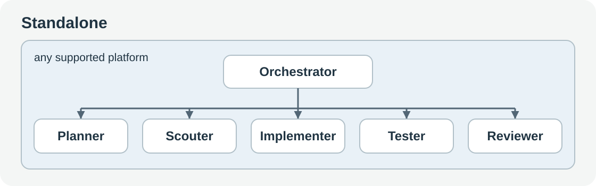
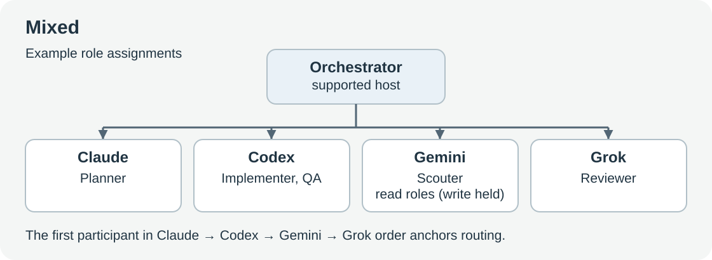

# ARC — Agent Role Coordination

ARC coordinates scoped roles, handoffs, and verification in Claude Code, Codex, Gemini CLI, and Grok CLI. Start with one platform or choose where each role runs.

## Install

In an interactive terminal, run `npm install --global @yunhozz/arc` and then `arc`. To run without a global install, use `npx --yes @yunhozz/arc`.

| Requirement | Support |
|---|---|
| Environment | Node.js 22+, npm, Git, and network access. macOS 13+ or Linux with glibc 2.28+, on arm64 or x64. |
| Homes | ARC rejects symlinked platform homes or parents. `CLAUDE_CONFIG_DIR` must resolve to the default `~/.claude` if set. Leave `GEMINI_CLI_HOME` and `GROK_HOME` unset. |

## How ARC works

The Orchestrator in your conversation assigns work to specialists and accepts their results after the required checks.

| Role | Responsibility |
|---|---|
| Orchestrator | Routes work and accepts results |
| Scouter | Researches sources and explores the repository |
| Planner | Drafts designs, specs, and plans |
| Implementer | Makes assigned changes |
| Tester | Runs assigned verification |
| Reviewer | Independently reviews changes |

In **Standalone**, the Orchestrator and all five specialist roles run on the same platform.



In **Mixed**, a supported host routes each role to its configured platform. Execution support determines which routes are available.



The platforms you choose for roles and hosts determine the mode.

| Mode | Meaning |
|---|---|
| Standalone | The selected role platforms and hosts form one participant. |
| Mixed | Two or more platforms participate. The first participant in Claude → Codex → Gemini → Grok order anchors routing. |
| Unverified | Apply is blocked. Inspect the reported paths. |

See the [workflow contracts](docs/harness-operation.md#workflow-contracts) for approval, handoff, and verification rules.

## Manage ARC

Run `arc` to configure roles, check the installation, or remove ARC.

| Menu | Action |
|---|---|
| Configure | Choose role platforms, models, efforts, hosts, Run mode, language, and subagent limits. Select Apply to publish. |
| Status | View installed platforms, settings, diagnostics, and version. Select Upgrade when available. |
| Uninstall | Confirm removal of a platform or choose Everything (incl. CLI). |

Apply reports which platforms received a new installation and which received updated settings.

```text
✨ ARC installed for Claude.
🔧 Settings applied to Codex.
Restart ARC to check.
```

## Models and language

The Orchestrator uses the current conversation model. Each specialist starts with the packaged model and effort for its platform.

| Platform | Default model for every specialist | Default effort |
|---|---|---|
| Claude | `opus` | `effort = "medium"` |
| Codex | `gpt-6.2-sol` | `model_reasoning_effort = "medium"` |
| Gemini | `gemini-4-neon` | `effort = "default"` |
| Grok | `grok-4.6` | `effort = "default"` |

In Configure, edit each specialist's platform, model, and effort. Configure lists candidates from the packaged catalogs. Model access may vary by account. Configure also sets the agent response language for new sessions. See the packaged settings for [Claude](claude/skill/models.toml), [Codex](codex/skill/models.toml), [Gemini](gemini/skill/models.toml), and [Grok](grok/skill/models.toml).

## Watch sessions

Run `arc watch` in an interactive terminal. In Git, first choose a worktree. The picker uses `git worktree list` to find worktrees wherever they were created and selects the current worktree by default. Outside Git, watch uses the current directory. Next, confirm the platforms to watch and follow their events in the selected scope. All supported platforms are checked by default.

Claude and Codex are supported. Gemini and Grok appear in the platform menu as unavailable, and their sessions do not count toward worktree activity. A worktree with no recent activity can still be selected. Those rows are dimmed with color and show `(no recent activity)` without color. Run `arc watch --help` for options.

| Visibility | Events |
|---|---|
| Shown | Messages, SKILL and PLUGIN lines, dispatch records, and file changes. |
| Hidden | Tool and command outputs. Reasoning requires `--verbose`. |

Secret masking is incomplete.

The picker shows each worktree's path, branch or detached HEAD, and recent session activity. Here are five example rows.

```text
~/work/app                   main              here · ● 2m ago · 1 session · CODEX
app/.claude/worktrees/brief  feat/brief        ● 4m ago · 2 sessions · CLAUDE, CODEX
~/.codex/worktrees/7f3a/app  detached 1a2b3c4  18m ago · 1 session · CODEX
~/work/app-hotfix            hotfix/login      locked · (no recent activity)
app/.gemini/worktrees/docs   docs/refresh      (no recent activity)
```

After platform selection, the startup summary shows the scope, branch, platforms, and keys. Events then appear below it. Watch also shows shell file changes under the name of the most recent eligible session in the same worktree. It also reads sessions from platforms you did not select, without showing them, so their file changes are not shown under a selected session. The attribution is a best guess and can name the wrong session when several sessions are active at once.

```text
┌────────────────────────────────────────────────────────┐
│ arc watch 0.5.0                                        │
│ Scope      ~/work/app (main)                           │
│ Platforms  CLAUDE · CODEX                              │
│ Keys       Ctrl-C stop · Ctrl-H earlier · Ctrl-L clear │
└────────────────────────────────────────────────────────┘
11:58:00 CODEX  USER     Update the test guide.
11:58:01 CODEX  SKILL    arc
11:58:30 CODEX  EDIT     app/docs/testing.md
11:58:31 CODEX  AGENT    Updated the test guide.
```

Press Ctrl-H to page through earlier events in loaded history.

```text
── earlier 2 events · start of loaded history ──
11:57:40 CODEX  USER     Check the test commands.
11:57:42 CODEX  AGENT    The quick check is npm test.
── back to live ──
```

The status block at the bottom shows the watched path.

```text
~/work/app
```

## Platform support

Standalone is verified for all four platforms in the registry. For Mixed, check host and bridge support before assigning roles. The caller declares `executionEnvironment` without inferring it from paths. Desktop environments are held. See [execution support](docs/harness-operation.md#execution-support) for measured coverage.

| Platform | Host | As bridge target | Auth check |
|---|---|---|---|
| Claude | Yes | All roles. Implementer and Tester are sandboxed (`G1`). | `claude auth status` |
| Codex | Yes | All roles | `codex app-server` auth refresh (network) |
| Gemini | Held (`GG2`) | Read roles. Write roles are held (`GG1`). | None (`unknown`, `auth unverified`) |
| Grok | Yes | All roles. Write roles use a per-dispatch sandbox profile (`GK1`). | None (`unknown`, `auth unverified`) |

Codex hosts require escalation approval on every runtime call. Start Grok hosts with `grok --permission-mode default` and use `Allow once` on every runtime call.

### Bridge 도구 접근

Orchestrator는 현재 dispatch에 필요한 접근만 `toolAccess`로 요청합니다. Codex·Claude bridge의 Implementer와 Tester는 기본으로 임시 작업 디렉터리와 캐시 설정을 받습니다. Implementer는 loopback을 요청할 수 있고, Tester는 도메인 제한 외부망이나 브라우저 서비스를 요청할 수도 있습니다. 두 플랫폼에서 `network.domains`와 `browser-cdp`는 조건부 허용이며, `network.full`과 Playwright 서비스 3종은 보류 상태입니다. Grok의 도구 접근은 미측정 상태이며 Gemini는 보류 상태입니다.

- **영구 금지** — 작업 트리의 `.git`·`.codex`, CLI 홈, 인증·설정 경로, 셸 시작 파일, LaunchAgents·Keychains에 대한 쓰기 권한과 Docker·Colima·SSH agent·GPG agent 소켓 접근은 부여하지 않습니다.
- **호스트 전용** — `ps`·`pgrep` 등 다른 프로세스 조회, Docker, 실제 CLI 인증·설정 쓰기, 의존성 설치와 그에 필요한 외부 fetch, Git 쓰기, Cypress, 키체인 작업은 Orchestrator가 권한을 확인해 호스트에서 수행합니다.

요청별 역할 제한, gate와 측정 근거는 [운영 가이드의 도구 접근 절](docs/harness-operation.md#bridge-도구-접근)에 있습니다.

## Upgrade

- Status → Upgrade automatically reapplies the current configuration. Use Configure → Apply if reapplication is held or interrupted, its state is unknown, or this is the first npx upgrade from 0.4.6 or earlier. If the state is unknown, inspect the reported paths before retrying. In-progress plan workflows with changed versions are held under `cooperative.versions`.
- Before downgrading from Full Auto, switch Run mode to Supervised and Apply. Older CLIs read the v2 `settings.toml` as incomplete. After downgrading, run Configure in the older version to restore its composite layout.
- For older Mixed installations, see [legacy migration](docs/harness-operation.md#legacy-migration).

## Guides

[Harness operation](docs/harness-operation.md) · [Claude Code](claude/skill/SKILL.md) · [Codex](codex/skill/SKILL.md) · [Gemini CLI](gemini/skill/SKILL.md) · [Grok CLI](grok/skill/SKILL.md)
