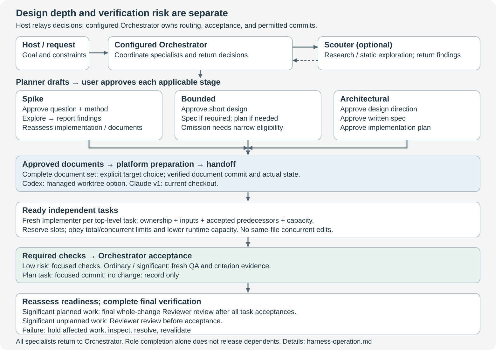
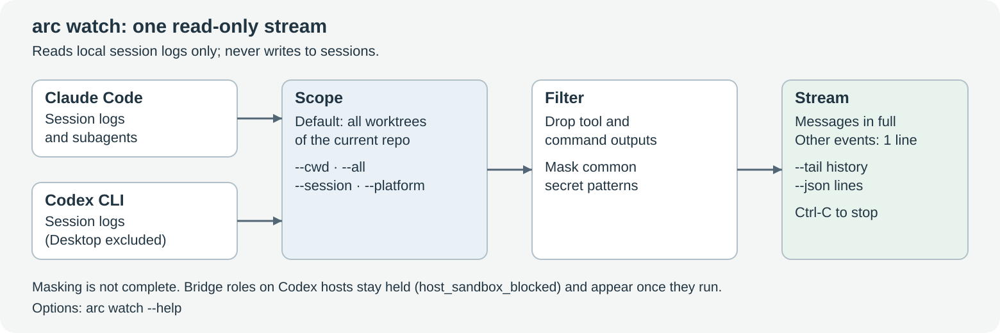
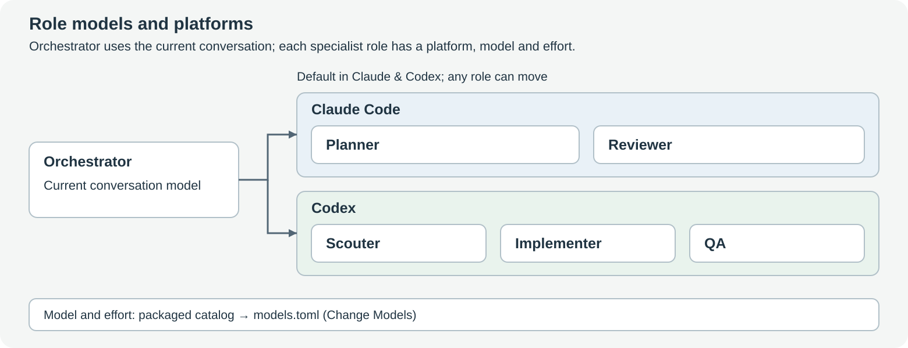

# ARC — Agent Role Coordination

ARC coordinates work in Codex and Claude Code through scoped roles, clear handoffs, and verification.



## Roles

| Role | Responsibility |
|---|---|
| Orchestrator | Routes work and accepts results |
| Scouter | Researches sources and explores the repository |
| Planner | Drafts designs, specs, and plans |
| Implementer | Makes assigned changes |
| QA | Runs assigned verification |
| Reviewer | Independently reviews changes |

## Install

**Requirements:** Node.js 22+, npm, Git, and network access. Supported platforms: macOS 13+ and Linux with glibc 2.28+ (arm64 or x64). Windows and musl Linux are not supported. Python, a compiler, and `node-gyp` are not required.

```sh
npm install --global @yunhozz/arc
arc
```

Package installation provides the CLI, not the harness. Install or manage the harness in the interactive TUI. To open it without a global install, run `npx --yes @yunhozz/arc`.

## Manage ARC

- **Install or update:** Choose Codex, Claude Code, or both in `Install / Update`, edit each role, then select `Apply`. `Settings` configures language, subagent limits, and global configuration for installation. `Change Models` edits role models and efforts.
- **Version:** `Check Version` shows `<current> → <latest>` with `Upgrade` when an upgrade is available, `Up to date (<current>)` for the current version, or current/latest details and any lookup error otherwise. `Upgrade` preserves settings; global upgrades exit ARC, while npx upgrades leave the global CLI unchanged.
- **Uninstall:** Choose `Codex`, `Claude`, or `Everything (incl. CLI)`, then confirm with `Remove` (the default is `Back`). `Back` returns to Uninstall; Esc returns home. Everything removes both harnesses and the global CLI only if harness removal succeeds. Unselected harnesses and user files remain. To remove only the CLI, run `npm uninstall -g @yunhozz/arc`.

The TUI requires terminal input and output. Public commands: `arc`, `arc watch`, `arc --help`, `arc --version`; help, version and `arc watch` also work without a TTY.

## Watch sessions



`arc watch` streams Claude Code and Codex activity read-only. Default scope: every worktree of the current Git repository, or the current directory outside Git.

- **Shown:** user and agent messages in full; other events on one line.
- **Hidden:** tool and command outputs. Common secret patterns are masked, but masking is not complete.
- **Excluded:** Codex Desktop sessions. Bridge roles on Codex hosts stay held as `host_sandbox_blocked` until they run.

Run `arc watch --help` for scope, platform, history and JSON options; press Ctrl-L to clear the screen and Ctrl-C to stop.

## Models and language



- **Orchestrator:** the current conversation model.
- **Specialist roles:** active settings in [Codex](codex/skill/models.toml) or [Claude Code](claude/skill/models.toml); edit them with `Change Models`.
- **Claude & Codex:** each role runs on either platform. New configurations put Planner and Reviewer on Claude and the rest on Codex. `Apply` publishes; start a new session to load new profiles.
- **Catalogs:** model and effort choices come from packaged catalogs, with no API key or model-list call; a choice is not proof that your account can use it.
- **Language:** the TUI is in English; the selected response language applies to agents in new sessions.
- **Execution support:** `claude-cli` hosts run native roles and Codex bridges. `codex-cli` hosts hold every bridge as `host_sandbox_blocked`; Claude bridge Implementer and QA roles on a Codex host are also held as `permission_scope_unverified`. On Desktop, every role (native and bridge) is held as `environment_unverified` pending a future ARC update. After upgrading to `cooperative-8`, run Install / Update again.

Authentication checks, role execution support per environment, and switching between composite and single-platform modes: see [Harness operation](docs/harness-operation.md).

## Guides

[Harness operation](docs/harness-operation.md) · [Codex guide](codex/skill/SKILL.md) · [Claude Code guide](claude/skill/SKILL.md)
