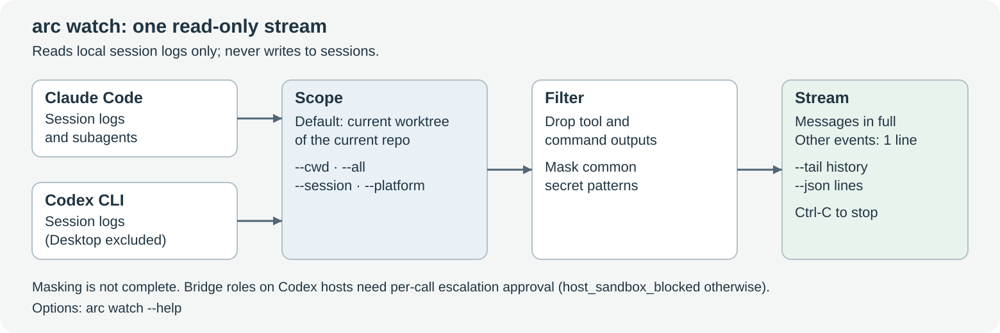

# ARC — Agent Role Coordination

ARC coordinates work in Claude Code and Codex through scoped roles, clear handoffs, and verification. Gemini CLI integration is registered but not yet verified.


## Roles

| Role | Responsibility |
|---|---|
| Orchestrator | Routes work and accepts results |
| Scouter | Researches sources and explores the repository |
| Planner | Drafts designs, specs, and plans |
| Implementer | Makes assigned changes |
| QA | Runs assigned verification |
| Reviewer | Independently reviews changes |

## Install

**Requirements:** Node.js 22+, npm, Git, and network access. Supported platforms: macOS 13+ and Linux with glibc 2.28+ (arm64 or x64). Windows and musl Linux are not supported. Python, a compiler, and `node-gyp` are not required.

Platform homes and their parent directories must not be symbolic links; ARC refuses to install, publish or take routing locks through them.

```sh
npm install --global @yunhozz/arc
arc
```

Package installation provides the CLI, not the harness. Install or manage the harness in the interactive TUI. To open it without a global install, run `npx --yes @yunhozz/arc`.

## Manage ARC

- **Install or update:** `Install / Update` opens the role diagram immediately. Each box has the role name on its top border and the platform, model, and effort inside. Enter on a role opens one editor with `Platform`, `Model`, `Effort`, `Done`, and `Back`; use ←/→ to cycle values or Enter to open the selection flow. `Done` saves to the draft; `Apply` installs or updates it. Narrow terminals show compact role rows.
- **Hosts and mode:** `Hosts` selects the CLIs you will work in. Platforms used by roles stay checked and locked as `(used by roles)`. The participant set S = role platforms ∪ hosts: one platform means standalone; two or more mean `Mixed (…)`, such as `Mixed (Claude + Codex)`. The anchor is the participant with the lowest anchor order (Claude, then Codex, then Gemini); its home stores the active routing configuration.
- **Settings:** Choose language (`EN`/`KR`), total subagents, and concurrent subagents. Differing platform values show `(mixed)`: leave a field unchanged to preserve each platform's value, or edit it to apply one value across S. New installations use English, 100 total, and 5 concurrent subagents. Installation includes managed instructions and native settings.
- **Version:** `Check Version` shows `<current> → <latest>` with `Upgrade` when an upgrade is available, `Up to date (<current>)` when no newer version is available, or `<current> (latest unavailable)` and a lookup error otherwise. Success shows `Upgraded to <version>.` `Upgrade` preserves settings; global upgrades exit ARC, while npx upgrades leave the global CLI unchanged.
- **Uninstall:** Rows are `Claude`, `Codex`, `Gemini`, `Everything (incl. CLI)`, and `Back`; `(not installed)` rows cannot be selected. Confirm `Remove ARC from <Label>?` or `Remove ARC from all platforms and the arc CLI?` with `Remove` (the default is `Back`). Removing a Mixed participant also warns `Mixed routing will be turned off.` `Back` returns to Uninstall; Esc returns home. Everything removes harnesses with verified install/standalone capabilities and the global CLI only if harness removal succeeds. Use the individual Gemini row for files left while its capabilities are off. Success shows `Removed from <Label>.`, `Removed ARC and CLI.`, or `Removed ARC.` if the CLI was already absent; a mode switch adds `Mixed routing turned off.` first. Unselected harnesses and user files remain. To remove only the CLI, run `npm uninstall -g @yunhozz/arc`.

The TUI requires terminal input and output. Public commands: `arc`, `arc watch`, `arc --help`, `arc --version`; help, version and `arc watch` also work without a TTY.

## Watch sessions



`arc watch` streams Claude Code and Codex activity read-only. Default scope: the current Git worktree, or the current directory outside Git. Each event follows its session's working directory at that point, so a session that moves into another worktree appears in that worktree's watch instead. Skills and plugin tools in use are shown as SKILL and PLUGIN lines.

- **Shown:** user and agent messages in full; other events on one line.
- **Hidden:** tool and command outputs. Common secret patterns are masked, but masking is not complete.
- **Excluded:** Codex Desktop sessions. Claude bridge Scouter, Planner and Reviewer on a Codex host need per-call escalation approval (otherwise `host_sandbox_blocked`) and appear once they run; Claude bridge Implementer and QA stay held.

Watch discovers the dispatch anchor through registered platform markers, with a legacy Codex-home fallback when no anchor is found. Conflicting anchors show `dispatch store ambiguous`. Gemini session discovery and conversation display are unsupported; dispatch records in the selected store remain visible. History left in an old anchor home is not combined with the current store.

Run `arc watch --help` for scope, platform, history and JSON options; press Ctrl-L to clear the screen and Ctrl-C to stop.

## Models and language


- **Orchestrator:** the current conversation model.
- **Specialist roles:** active settings in [Claude Code](claude/skill/models.toml), [Codex](codex/skill/models.toml), or [Gemini CLI](gemini/skill/models.toml); edit them through the `Install / Update` role boxes.
- **Mixed routing:** each role runs on a participating platform; hosts can participate without assigned roles. The diagram reuses a session draft first, then current Mixed roles and all participants as hosts. Otherwise it uses the first installed platform in display order (Claude, Codex, Gemini), with installed model settings. With no installation, it uses package defaults for the first platform passing the initial role availability check, falling back to Claude; catalogs are checked after that choice. An unverified installation shows `Mode: Unverified` and blocks Apply. `Apply` publishes; start a new session to load new profiles.
- **Catalogs:** model and effort choices come from packaged catalogs, with no API key or model-list call; a choice is not proof that your account can use it.
- **Language:** the TUI is in English; the selected response language applies to agents in new sessions.
- **Execution support:** `claude-cli` hosts run native roles and Codex bridges. `codex-cli` hosts run native roles and Claude bridges for Scouter, Planner and Reviewer after per-call escalation approval, which every runtime command needs there, native roles included (a refused approval or denied `CODEX_HOME` write is `host_sandbox_blocked`); Claude bridge Implementer and QA roles stay held as `permission_scope_unverified`. Declare `codex-cli` or `claude-cli` for terminal sessions, including IDE terminals; use a `-desktop` value only inside a Desktop app, never because of a path such as `~/Desktop`. On Desktop, every role (native and bridge) is held as `environment_unverified` pending a future ARC update. After upgrading to `cooperative-9`, run Install / Update again. `executionEnvironment` is declared by the caller and not verified by the runtime; declaring a CLI value inside Desktop bypasses the hold, so confirmed Desktop sessions must declare the Desktop value.

After upgrading, run `Install / Update` to migrate an existing Codex+Claude composite to the Claude home. Any non-terminal dispatch in either store holds the move; finish or cancel it before applying again. Previous dispatch history stays in the Codex home and is not merged into the new store. After migration, older ARC versions may see an unverified or standalone installation; run `Install / Update` in the older version to restore its composite layout after downgrading.

## Gemini CLI status

- **Verification:** Gemini `install` and `nativeProfile` are verified by live evidence ([install](docs/superpowers/evidence/gemini/install-2026-11-16.md), [nativeProfile](docs/superpowers/evidence/gemini/nativeProfile-2026-11-16.md)); the other seven capabilities remain `off`: `catalog`, `standalone`, `bridge`, `compositeRole`, `compositeHost`, `authProbe`, and `watch`. The home screen follows CLI status: `Not Available` when the CLI is missing, `Unsupported version` outside the supported range, and `Available (auth unverified)` otherwise; installation, standalone roles, composite roles/hosts, and bridges remain unavailable until their required capabilities are verified in a future ARC release. Packaged profiles and catalogs alone do not verify live behavior.
- **Authentication:** Gemini has no authentication probe. Status reports `unknown` without running a login check. Once capabilities, CLI version, and catalog gates pass, unknown authentication allows composite participation with an `auth unverified` warning; it does not prove login.
- **Permissions:** Gemini role permissions are checked only after the fact, and only within the git-visible worktree. Detection covers tracked and untracked files except Git-ignored paths, plus HEAD, branch, and ref changes; it proves no prevention of outside-worktree writes, network effects, or secret reads.
- **Effort:** Gemini effort is fixed at `default`.
- **Management:** `target:'all'` includes Gemini when its `install` and `standalone` capabilities are verified; it excludes Gemini while `standalone` remains off.

Authentication checks, role execution support per environment, and switching between composite and single-platform modes: see [Harness operation](docs/harness-operation.md).

## Guides

[Harness operation](docs/harness-operation.md) · [Codex guide](codex/skill/SKILL.md) · [Claude Code guide](claude/skill/SKILL.md) · [Gemini CLI guide](gemini/skill/SKILL.md)
