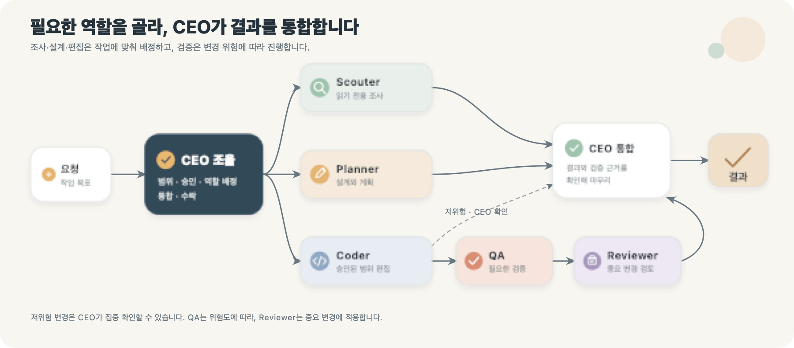

# Yunho Harness

Codex와 Claude Code에서 조사·설계·구현을 역할별로 나누고, CEO가 작업을 조율하고 통합합니다.



> 작업마다 필요한 역할만 배정합니다. QA와 Reviewer는 변경 위험과 범위에 맞춰 참여합니다.

## 👥 역할

| 역할 | 담당 |
|---|---|
| CEO | 조율·승인·통합·수락 |
| Scouter | 읽기 전용 조사와 정적 탐색 |
| Planner | 설계와 구현 계획 |
| Coder | 승인된 범위의 파일 편집 |
| QA | 독립 검증 |
| Reviewer | 중요 변경의 독립 검토 |

## 🚀 설치

**필요:** Python 3.11+, Node.js/npm(`npx`), Git, 네트워크 연결.

저장소 루트에서 설치 대상을 하나 지정합니다.

```sh
./install.command --target codex
./install.command --target claude
```

`--target`은 필수입니다. 설치기는 `brainstorming`, `writing-plans`, `test-driven-development`를 [obra/superpowers](https://github.com/obra/superpowers)에서 가져옵니다.

| 대상 | 설치 위치 |
|---|---|
| Codex | `~/.codex` (또는 `CODEX_HOME`), `skills/`, `agents/`, `AGENTS.md`, `config.toml` |
| Claude Code | `~/.claude`, `skills/`, `agents/`, `CLAUDE.md` |

기존 관리 파일은 갱신 전에 백업합니다. 전역 안내와 설정을 건너뛰려면 `--skip-global`을 추가하세요.

## 🔎 설치 전 확인

```sh
./install.command --target codex --check
./install.command --target codex --dry-run
```

`--check`는 설치 파일과 경로를 검사하고, `--dry-run`은 변경 대상을 보여줍니다. 둘 다 파일을 바꾸거나 네트워크에 접속하지 않습니다.

## ⚙️ 모델 설정

역할별 모델 설정은 [Codex](codex/skill/models.toml)와 [Claude Code](claude/skill/models.toml)에 있습니다.

## 📚 자세히 보기

- [Codex 운영 지침](codex/skill/SKILL.md) · [Claude Code 운영 지침](claude/skill/SKILL.md)
- [계획](codex/skill/references/planning.md) · [작업 인계](codex/skill/references/handoff.md) · [검증](codex/skill/references/verification.md)
