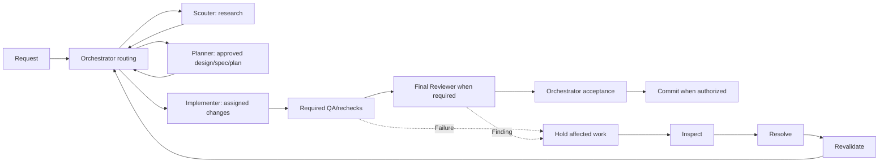
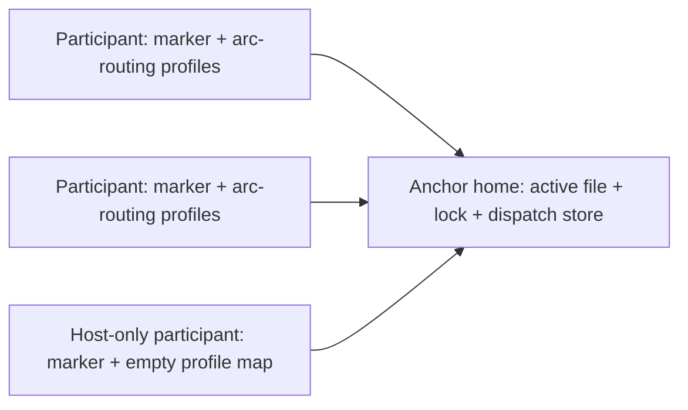
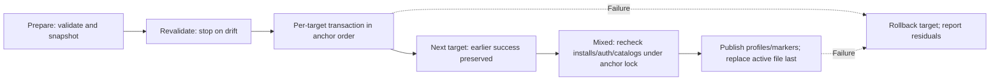

# How the ARC harness operates

ARC installs files; the conversation Orchestrator coordinates work. Normative contracts: [Claude](../claude/skill/SKILL.md), [Codex](../codex/skill/SKILL.md), [Gemini](../gemini/skill/SKILL.md), references, and profiles; this guide adds no approval gates.
Scheduling/limits are prompt policy, not interception or a sandbox; native settings affect their own sessions. Structural checks do not prove live compliance or application; verify in new sessions.

Simple questions stay with Orchestrator; diagram stages depend on risk/plan rules below. Significant planned final review follows task acceptance/commits; significant unplanned review precedes acceptance.

## What ARC installs

| Component | Claude Code | Codex | Gemini CLI |
|---|---|---|---|
| Home | `~/.claude`; conflicting `CLAUDE_CONFIG_DIR` rejected | `~/.codex` or `CODEX_HOME`; relative to CLI cwd | `~/.gemini`; any `GEMINI_CLI_HOME` rejected |
| Skill | `skills/arc/` | Same | Same |
| Models | `skills/arc/models.toml` | Same | Same |
| Limits | `skills/arc/limits.toml` | Same | Same |
| Five specialist profiles | `agents/arc-*.md` | `agents/arc-*.toml` | `agents/arc-*.md` |
| Managed instructions | `CLAUDE.md` | `AGENTS.md` | `GEMINI.md` |
| Native settings | `settings.json` | `config.toml` | `settings.json` preserved; no native settings written |

- `models.toml` schema v3: `version = 3`, five `[roles.<role>]` tables with exactly `model` and `model_reasoning_effort` (Codex) or `effort` (Claude/Gemini). Orchestrator uses the conversation model.
- Legacy v1/v2 validates/converts to active values; writes use v3. Catalogs are packaged candidates, not account/version/provider availability; absent saved pairs stay visible but require reselection before Apply.

## Mixed routing

| Contract | Rule |
|---|---|
| Participants | S = role platforms ∪ hosts; one = standalone, two or more = `Mixed (…)` |
| Anchor | Display and anchor order: Claude > Codex > Gemini |
| Active file | `<anchor home>/arc-role-platform-routing.json`; new schema v2 explicitly lists anchor-ordered platforms |
| Lock and store | Routing lock and `arc-role-dispatch/` in the anchor home |
| Participants | `arc-role-platform-routing.prepared.json` points to active file; `agents/arc-routing-*` for assigned roles; host-only marker has an empty profile map |
| Activation | Host marker discovers anchor; runtime revalidates active config/all markers under lock and requires matching installed bytes. Historical v1 is migration-only; markers prove no login/permissions/model/effort. Apply publishes; reload in a new session |
| Paths | Symlinked homes/parents refused for install, publication, locks |

- New leases are v2: `targetPlatform` comes from the assigned role and must belong to S; native target = host, bridge target differs; run/observe/resume/cancel derive it from the lease.
- v1 read compatibility covers Claude/Codex hosts only (native = host, bridge = peer); other v1 hosts hold as `activation_unverified`.

## Status and authentication

| Status or platform | Meaning or method |
|---|---|
| `Available` | CLI available |
| `Not Available` | CLI missing |
| `Unauthorized` | Permanently rejected auth refresh |
| `Incomplete` | Inconclusive check, never `Available` |
| `Not verified`, `Unverified` | Verification/installation consistency unresolved |
| `Unsupported version` | CLI version outside the supported range |
| Codex | Home/composite auth uses `codex app-server` `getAuthStatus`; network refresh rotates `CODEX_HOME/auth.json` tokens |
| Claude | `claude auth status` |
| Gemini | `auth.kind: none`, no probe, status `unknown`; `auth unverified` warning, not proof of login |

Unknown Claude/Codex probe results block participation.

## Execution support

| executionEnvironment | Support and holds |
|---|---|
| `claude-cli` | Native roles and Codex bridges |
| `codex-cli` | Native roles and Claude Scouter/Planner/Reviewer bridges; every runtime command needs per-call escalation approval, including native commands, because it may write `CODEX_HOME`. Refusal/denied write: `host_sandbox_blocked`; runtime does not check approval: Orchestrator must obtain it |
| `claude-desktop`, `codex-desktop` | All native/bridge roles: `environment_unverified`; support capped at `unverified`. No checklist recording/release in this version; future checks: CLI discovery, shared auth, same worktree, supervisor survival, per-call escalation, matching native revision tag |

`executionEnvironment` is caller-declared, not runtime-verified: terminal/TUI/IDE terminal uses `codex-cli` or `claude-cli`; confirmed Desktop app uses its Desktop value. Never infer from paths; when unsure use CLI. A false CLI declaration bypasses the Desktop hold.

| Bridge contract | Guarantees and limits |
|---|---|
| G1 `fail` | Claude Implementer/QA on Codex held: `permission_scope_unverified`; injected sandbox unverified |
| G2 `escalation` | Codex-host calls require approval; no advance hold; detached supervisor survival observed under variant conditions |
| G3 `pass` | Codex re-delegation is not prevented; rollout spawn detection fails dispatch: `delegation_observed` |
| G4 `pass` | Current Codex gate permits dispatch; a failed gate would hold `permission_scope_unverified` |
| G5 `wide` | Codex `workspace-write` can reach outside worktree; post-run detection does not cover those writes |
| Claims | `supportStatus: verified` requires all five claims `runtime-observed`; Codex permissions capped at `operator-attested` (`user-config-mcp-not-controlled`, user MCP config) |
| Versions | Claude/Codex versions reported, not restricted |
| Detection | Compare git-visible tracked/untracked paths, HEAD, branch, every ref; ignored paths excluded |
| Child guard | `ARC_BRIDGE_CHILD` denies routing commands, but shell `codex exec` / `claude -p` is not detected delegation |

## Install, update, remove

| Operation or mode | Action and confirmation |
|---|---|
| CLI | `arc`, `arc watch`, `arc --help`, `arc --version`; TUI needs both TTYs, invalid/non-TTY no-argument calls exit 2; help/version/watch need no native installer |
| Home | Install / Update, Check Version, Uninstall, Exit |
| Diagram | Role boxes → Platform/Model/Effort → Done → Apply; compact rows on narrow terminals. Reuse draft, then composite, then first installed platform, else available platform defaults (fallback Claude); catalog failure blocks participating platform, no automatic reselection. Unverified blocks Apply |
| Settings | Defaults EN/100 total/5 concurrent; unchanged mixed fields preserve values; edited values apply across S |
| D1-a: size 1, standalone | Install/update selected P; other standalone homes untouched |
| D1-b: size 1, Mixed | Confirm `Switch to <Label>` / `Mixed routing will be turned off.` (default Back); restore standalone in installed homes transactionally, then reprepare selected operation; later failure leaves restored standalone |
| D1-c: size ≥2, new | Install S in anchor order; publish at anchor |
| D1-d: size ≥2, same S | Install S in anchor order; republish at anchor |
| Mixed publication | Owned standalone profiles replaced with routing profiles; rollback restores original bytes |
| D1-e: size ≥2, changed S | Mode preview, no extra confirmation; install additions, transactionally restore departing standalone profiles/publish new markers; departing homes retain ARC. Anchor move locks old/new in ascending order, releases reverse; any non-terminal native/bridge lease in either store holds move |
| Update | Exact displayed version revalidated before upgrade; no newer/unavailable latest offers no Upgrade. Global replacement exits; npx preserves global CLI. Same-version refresh: Install / Update; broken CLI: `npx --yes @yunhozz/arc@latest` |
| Preservation / holds | Preserve outside managed blocks, unrelated settings/shared skills; malformed policy/config stops install. Omitted valid limits survive; concurrency mismatch needs explicit selection. Skip-global omits this operation's instructions/native settings, not prior changes. Unverified profiles preserved as residuals; inconsistent routing blocks publication/switch/remove; active bridges block publication/deactivation |
| Native settings | Codex wait config merges supported `[features.multi_agent_v2]`, otherwise guidance; concurrency: integer `[agents].max_concurrent_threads_per_session`, Claude string `settings.json.env.CLAUDE_CODE_MAX_CONCURRENT_SUBAGENTS` |

Legacy migration (only consistent Codex-home v1 is legacy; v2/multiple active files/inconsistency is unverified):

1. Run Install / Update → Apply; acquire Claude then Codex anchor locks; no extra migration confirmation.
2. Inspect both stores; any non-terminal lease holds before writes. Finish/cancel; lost supervisors/corrupt leases/uncertain exit require manual inspection/cleanup, never automatic deletion.
3. One transaction writes Claude-home v2, repoints markers, removes old active file; failed recovery reports residual paths, restored rollback permits later Apply.
4. Leave history in old store (never merged/read by runtime after move), release locks in reverse; legacy runtime holds `activation_unverified`. Legacy removal uses old anchor; downgrade needs older Install / Update.

- `cooperative-9`: re-run Install / Update for all participants; active dispatches block publication; unknown/unsupervised starting leases need manual cleanup.
- In-flight plan commands, including status, hold with `cooperative.versions`; results only, unresolved `versions-changed`; no automatic migration/approval renewal. Finish/handoff before upgrade or start fresh with new evidence/approvals.

| Uninstall | Scope and boundaries |
|---|---|
| Platform row | Confirm Remove (default Back); absent rows disabled. Mixed participant first restores others to standalone. Remove selected skill/profiles/managed blocks including edited ARC files; preserve other skills/profiles, native concurrency/wait/workflow records, unselected homes/user files; unclear ownership preserved/reported |
| Everything (incl. CLI) | Verified install/standalone platforms only; refused when a platform home cannot be resolved. Harness success required before verified global CLI removal, including npx; identity/context failure blocks harness writes; CLI failure preserves harness success; CLI removal ends session; preserve other packages/npx cache |
| CLI only | `npm uninstall -g @yunhozz/arc`; harness remains |

| Result | Message |
|---|---|
| Install | `ARC installed for <Label>.` |
| Mixed | `Mixed (…) activated.` |
| Remove | `Removed from <Label>.`, `Removed ARC and CLI.`, or `Removed ARC.` (CLI absent) |
| Switch | First adds `Mixed routing turned off.` |
| Upgrade | `Upgraded to <version>.` |
| Failure | `Error: <message>`, deduplicated `Residual path: …`, `Exit code: N`; earlier target success remains visible; rollback label proves no cleanup/backup |

## Watch

| Concern | Behavior and limits |
|---|---|
| Options | `arc watch --help`; `--cwd`, `--all`, `--session`, `--platform`, history, JSON |
| Sources | Codex rollout JSONL, Claude transcripts/persisted bridges, dispatch leases/artifacts |
| Scope | Current entire Git worktree or directory outside Git; exclude linked/nested worktrees, Codex Desktop/descendants. Per-event session cwd (not command cwd); subagents use own cwd, follow tracked parent in all/session scope. Unidentified dispatch worktree needs all/session or followed session |
| Anchor | Marker active directory must match resolved registered home; one candidate selects store, none → legacy Codex, multiple → `dispatch store ambiguous` (other sources continue). No old-history merge |
| Shown | Full USER/AGENT messages; role prefix when known; EDIT/CREATE/DELETE list all paths; other events one line |
| Hidden | Tool/command outputs, skill definitions/args, MCP args/results; reasoning only verbose; incomplete secret masking applies to JSON too |
| Read-only | No network or CLI except restricted Git discovery/listing; no writes |
| Display | TTY/width wraps messages/file lists; JSON v1 preserves message lines/absolute paths; other text capped at 1000 code points. Ctrl-L clears TTY, Ctrl-C/signals exit 0; spinner ends after interrupt/5 minutes idle |
| Shell detection | Git file list + lstat metadata, no content; inferred attribution may be wrong/include external edits/duplicate late tool events; ignored paths, unchanged fingerprints, non-Git roots missed. Own symlink metadata, no directories; other lstat errors retain prior fingerprint. Delay ~1s, ≥3s interval, ≤2 roots/tick, ≤32 roots; live path claims suppress one inferred report within 2 minutes; JSON adds `inferred:true` |
| Bounds | Poll 500ms/discover 2s/exclusions 30s; 64 files, 1MiB/file/tick, 256KiB history/session, 64KiB cwd probe, 4MiB/line, 30min inactivity, 32 all-scope repositories; disable shell detection after >20000 files or 3 listing failures (timeout/buffer overflow included). Merge order per tick only; truncate/regrow past offset can be missed |

| KIND | Meaning |
|---|---|
| USER | User message |
| AGENT | Agent message (ARC role prefix when known) |
| CMD | Command; literal successful Claude rm targets are not a filesystem audit |
| EDIT | File edit |
| CREATE | File creation |
| DELETE | File deletion |
| TOOL | Tool call |
| SKILL | Skill call; Codex skill-only reads deduplicated per turn; verbose also shows CMD |
| PLUGIN | Plugin call |
| TOOL! | Tool failure |
| SPAWN | Agent creation |
| DISPATCH | Routing dispatch |
| APPROVE | Approval |
| FAIL | Turn failure |
| ERROR | Error |
| SESSION | Session |
| END | Turn end |
| NOTICE | Notice |
| SETTINGS | Settings |
| TURN | Turn start |
| THINK | Reasoning |
| ITEM | Other item |

## Workflow rules

| Role | Return to Orchestrator (specialists at depth 2, no delegation) |
|---|---|
| Scouter | Sources/facts/uncertainty, no edits |
| Planner | Complete drafts/criteria, no implementation |
| Implementer | Scoped changes/checks/limits, no acceptance |
| QA | Independent criterion evidence, no edits |
| Reviewer | Final correctness/facts/security findings, no edits |

| Design path | Approval and preparation |
|---|---|
| Spike | Question/method/scope/criteria/constraints; probe-only grants no implementation |
| Bounded | Short design, spec by judgment, plan as needed |
| Architectural | Design → approved written spec → approved implementation plan |
| Target | Explicit target before preparation; approved docs/verified commits before handoff; plan approval chooses no target; preserve unrelated ownership |
| Plan omission | One local change, no dependent stages/shared state/lifecycle/order concerns, one focused path |
| Small direct path | Prove all F1–F8 in the platform handoff; retain later gates. Reuse instruction reads only with verified source-set/hashes and same conversation; record envelope, refresh current state/evidence separately from valid target choice; missing/conflicting/inaccessible/ambiguous evidence requires full evaluation/hold |
| Scheduling | Ready work needs approvals/inputs/contracts/predecessor evidence/acceptance/verified commit or no-change/capacity; serialize shared Git/files |
| Limits | Freeze valid limits, reserve batches; nested/non-ARC descendants count, waiting consumes active capacity, completion frees active not cumulative, unknown is not zero; exhaustion waives no gate |

| Risk | Verification flow |
|---|---|
| Narrow, understood, reversible, focused-verifiable | Implementer or approved direct edit → focused checks |
| Ordinary behavior | Implementer → fresh QA; failure-first TDD unless recorded qualifying waiver (RED/GREEN only); non-behavior exception names structural checks |
| Significant planned | Fresh Implementer and required QA per task (same-task QA corrections may reuse); all QA/rechecks → task acceptance/commits → one final Reviewer |
| Significant unplanned | Fresh Implementer → fresh QA/rechecks → final whole-change Reviewer → acceptance; same-task QA corrections may reuse |
| Instruction provenance | Brief separates user/workspace/installed/input sources and access/version/approval; missing root AGENTS.md invalidates no user instruction |
| Visual evidence | Source/version/approval/criteria/method + actual output/revision/basis required: pass/mismatch/unverified; fresh QA compares, self-report cannot replace it. Structure/synthetic Claude.app observation proves no Claude Code CLI execution |

- Reuse valid explicit approvals/targets/commits; silence/restart grants no authority. Specific requests may authorize scope; material scope/method/risk/new decisions require revised approval; continue authorized correction/checks to completion.
- Orchestrator owns Git/acceptance: after required checks/acceptance, one focused task commit; no-change record only; preserve unrelated work, verify SHA/content/state. Push/merge/publish/deploy require separate authorization.
- Significant planned final Reviewer findings repeat Implementer → Reviewer, no QA reassignment; fixes uncommitted until recheck/acceptance, then one focused follow-up; separate QA findings remain Implementer → QA.
- Contract-preserving task progress needs no new approval; other spec/plan edits require revised approval. Keep approved revisions pending for first accepted top-level task executed/reconfirmed against them, otherwise current task/final Reviewer follow-up; only with no implementation left/no such commit may one standalone `docs(plan)` closing commit include all revisions, no implementation. Overall completion leaves none pending.
- Record `Plan-Revision`, per-version `Plan-Approved-At` (actual ISO 8601), `Plan-Reason` trailers with ASCII `->`; preserve trailers/approval chronology; never amend/reset/replay/rewrite or create other docs/fixup commits. Full rules: [planning](../codex/skill/references/planning.md#plan-updates-during-execution), [preparation](../codex/skill/references/handoff-prep.md#execution-time-plan-revision), [commit](../codex/skill/references/commit.md#execution-time-plan-document-updates). Repository commit descriptions are concise Korean.
- Failure: no automatic retry/fallback/stash/reset/clean/lock deletion/permission changes/bypass. Optional failed reads allow only brief-preauthorized side-effect-free alternatives with exact locator/version/purpose/authority/equivalent evidence; missing inputs/unknown/partial changes return immediately. Resume preserves approvals/completed work/failure/resolution/valid-invalid evidence/holds/next goal.

1. Record exact failed check, baseline/current revision, evidence, path/branch or detached HEAD/index/files/completed steps.
2. Classify baseline/current impact and dependencies.
3. Hold affected/dependent or impact-unknown work only; inspect, resolve, revalidate before resuming.
4. Orchestrator validates authority/target/inputs/ownership/gates and releases approved independent work without unrelated delays; roles never self-release.
5. Keep acceptance held while required checks remain unresolved; never hide failures/change criteria/waive checks.

## Maintenance and source map

| Maintenance | Effect and boundaries |
|---|---|
| Reinstall | Active v3 settings survive reinstall/upgrade; packaged static files refresh, valid omitted limits survive; managed profiles/local manual edits replaced without persistent backup; new sessions required |
| Static references | Shared and platform-specific files compose into installed references. npm/ignore-scripts/ZIP/clones use packaged references; source has no install hook, published postinstall informational only; no harness download/TTY/shell changes |
| Runtime | Generated into shared payload |
| Explicit upstream refresh | Local ignored `scripts/update-superpowers-local.sh` calls tracked updater, per-checkout only, absent from packages. One revision updates mapped platforms/manifest together; failure restores files/manifest, residuals reported. No automatic refresh on install/upgrade; concurrent same-target refresh/install/remove unsupported; provenance proves local consistency, not upstream authenticity |
| Manifest | Update/check `MANIFEST.sha256`; models excluded |
| Cleanup | Valid old completion blocks removed, no new shell registrations; status never edits shell files. Installer rollback and agent Git recovery are separate; inspect residuals |

| Concern | Source |
|---|---|
| Workflow contracts | Platform SKILL.md above and linked references: [Codex](../codex/skill/references), [Claude](../claude/skill/references), [shared](../shared/skill/references); [worktree preparation](../shared/skill/references/handoff-worktree.md) |
| Profiles and models | [Codex](../codex/agents), [Claude](../claude/agents), [Gemini](../gemini/agents); [model settings](../README.md#models-and-language) |
| CLI and management | [Root](../lib/cli/root.mjs), [TUI](../lib/tui/app.mjs), [operations](../lib/management/operations.mjs) |
| Installation and routing | [Targets](../lib/installer/targets.mjs), [plans](../lib/installer/plan.mjs), [settings](../lib/installer/runtime-config.mjs), [install](../lib/installer/install.mjs), [remove](../lib/installer/uninstall.mjs), [transactions](../lib/installer/transaction.mjs), [bridge gates](../lib/runtime/role-dispatch-policy.mjs) |
| Maintenance checks | [Updater](../scripts/update-superpowers.mjs), [manifest](../scripts/update-manifest.mjs), [runtime copies](../scripts/update-runtime-assets.mjs), [harness tests](../tests/test_harness_contract.py), [Node tests](../tests/node) |
